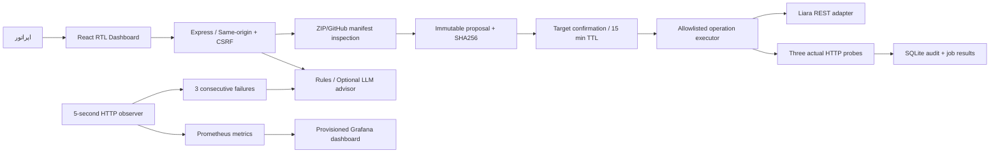

# معماری راه‌بان

## مسیر استاندارد انتشار

## تصمیم‌های کلیدی

- **AI و اجرا جدا هستند.** مدل بر اساس شواهد حذف‌اسرارشده تحلیل می‌دهد؛ انتخاب action فقط از enum مشخص API پذیرفته می‌شود. خروجی مدل به shell یا ابزار mutation وصل نیست.
- **تأیید سمت سرور است.** payload، mode، حساب، تیم، نسخهٔ اتصال و hash بسته در پیشنهاد ثابت‌اند. نام دقیق هدف تأیید می‌شود؛ تغییر payload از endpoint اجرا قابل قبول نیست.
- **پایداری عملیات.** تأیید با UPDATE شرطی از pending به executing تغییر می‌کند. اجرای دوباره رد می‌شود. برای هر هدف فقط یک job هم‌زمان اجرا می‌شود. پس از crash، اجرای ناقص خودکار تکرار نمی‌شود و interrupted علامت می‌خورد.
- **موفقیت قابل سنجش.** ساخت app، پذیرش restart، READYشدن release و سلامت HTTP مراحل متفاوت‌اند. پس از restart/deploy سه نمونهٔ موفق لازم است. خطای HTTP و پاسخ کندتر از ۱۵۰۰ms نمونهٔ ناموفق‌اند.
- **ناظر سبک و ایجنت رخدادمحور.** هر پنج ثانیه تا ده سرویس محیط فعال بررسی می‌شوند. بعد از سه شکست متوالی، یک رخداد باز با قواعد محلی و شواهد ساخته می‌شود. مدل فقط در بررسی درخواستی و با رضایت ارسال شواهد اجرا می‌شود.
- **حافظهٔ پروژه.** SQLite سرویس‌ها، منابع، jobها، approvalها، رخدادها، probes و زنجیرهٔ audit را ذخیره می‌کند. probes بعد از ۲۴ ساعت پاک می‌شوند؛ نمای برنامه یک ساعت اخیر را نشان می‌دهد. Grafana از TSDB مستقل Prometheus استفاده می‌کند.

## API لیارا

Origin ثابت `https://api.liara.ir` است. Bearer token فقط در سرور است. teamID به query افزوده می‌شود؛ redirect روی درخواست دارای کلید رد می‌شود.

| کار | API |
|---|---|
| فهرست سرویس‌ها | `GET /v1/projects` |
| پلن‌های قابل دسترس | `GET /v1/me` → plans |
| جزئیات و کلید متغیرها | `GET /v1/projects/:app` |
| لاگ | `GET /v2/projects/:app/logs`؛ start بر حسب ثانیه |
| ساخت سرویس | `POST /v1/projects/` |
| آپلود بستهٔ tar.gz | `POST /v2/projects/:app/sources` |
| ساخت release | `POST /v2/projects/:app/releases` |
| پیگیری release | `GET /v1/releases/:releaseID` |
| ری‌استارت | `POST /v1/projects/:app/actions/restart` |

پاسخ API با قرارداد مشاهده‌شده در CLI رسمی پیاده‌سازی و با انتشار نمونهٔ واقعی آزمون شد. برای multipart، فایل باید با MIME برابر `application/gzip` ارسال شود و payload نسخه شامل `platformConfig` است. API لیارا می‌تواند تغییر کند؛ خطا شفاف ثبت می‌شود. انتشار نیازی به اجرای CLI محلی یا shell ندارد.

## مرزهای MVP

مسیر Node.js، اپراتور محلی واحد، حداکثر ZIP فشرده ۱۰MB، ۴۰۰۰ فایل، هر فایل بازشده ۴MB و کل ۴۰MB. آرشیو روی دیسک استخراج نمی‌شود؛ فایل‌ها بدون اجرای کد در حافظه بررسی و به tar.gz تبدیل می‌شوند. پوشه‌های وابستگی و فایل‌های شناخته‌شدهٔ اسرار حذف می‌شوند. hash منبع قبل از آپلود دوباره بررسی می‌شود.

این معماری الگوهای تیم‌های بزرگ را در مقیاس MVP اعمال می‌کند. queue توزیع‌شده، HA، SSO، RBAC، مدیریت چرخش اسرار، مهاجرت دیتابیس و canary جزو نسخهٔ حاضر نیستند.

## دسترسی نسخهٔ سرور

Reverse proxy و TLS لیارا → ورود اپراتور (scrypt و نشست Secure) → مبدأ دقیق HTTPS → نشست API و CSRF → پیشنهاد و تأیید مستقل عملیات. SQLite و بسته‌های پروژه در دیسک `/app/data` می‌مانند. API keyها و نشست‌ها RAM هستند؛ پس از restart ورود و اتصال دوباره لازم است. Grafana روی این استقرار قرار ندارد.
