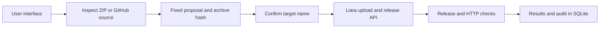

# Rahban architecture

React provides the dark interface. Express serves the built frontend and API. SQLite stores projects, proposals, jobs, incidents, HTTP observations, health-check schedules, GitHub update settings, runtime identity, and audit records. This is one application process; no Grafana, Prometheus, external worker, or message broker is required.

A root Dockerfile selects the `docker` platform. Initial inspection checks for a `FROM` instruction; the build must still succeed on Liara. Without a Dockerfile, `package.json` and a `start` script select `node`. The sample includes a Dockerfile. Archives are inspected in memory and converted to tar.gz. User code is not run on the Rahban server. ZIP input is limited to 10 MB.

Public GitHub imports resolve a repository and branch to an immutable commit SHA, then download that commit. An omitted branch resolves to the repository's default branch; an explicitly entered branch is retained. Pinning prevents a later branch update from changing the source being reviewed.

The port is inferred from `EXPOSE`, `PORT` in `.env.example`, or recognized JavaScript patterns, in that order; the fallback is 3000. Port, health path, response timeout, and build cache can be changed before approval and are fixed in the proposal. Environment-variable detection covers JavaScript/TypeScript; required values can be configured through a separate approved environment update or directly in Liara.

Proposals expire after 15 minutes and are bound to the destination, account, team, connection settings, and archive contents. Approval is single-use. Concurrent operations on one target are rejected. Jobs interrupted by a process restart are marked `interrupted` and are not replayed automatically.

Application creation, manual deployment, and restart require approval. The create-app proposal includes the selected available plan, bundle, private network, and resource-plus-bundle cost estimate; availability and price are checked again before creation. Deployment and restart require three consecutive HTTP 2xx responses after the operation. Redirects are not followed and do not count as success. If release checks cannot establish a final result, the job remains `needs_attention` for a later check. HTTP success does not establish correctness of every website route.

`GET /api/jobs/:id/retry` only restores a draft. It does not create a proposal or execute an operation. Known failed operations and completed deployments can be reviewed again; uncertain mutations must be resolved first. A fresh manual execution requires a new approval.

`server/management.js` exposes configuration key names, never values. `server/env-changes.js` merges an explicit patch into the existing environment in memory and stores only key names and fingerprints in the proposal. It checks that the base configuration is unchanged before sending Liara's complete environment list. Pending values expire with the approval, are consumed once, and disappear on process restart. Environment updates, start/stop, and app deletion all use the same exact-name approval gate. Deletion is irreversible and can remove attached app storage. Stop and delete operations pause both scheduled health checks and GitHub updates. Uncertain mutations expose **Verify outcome**, which checks the provider state appropriate to the operation without repeating it.

`DELETE /api/jobs/:id` marks an eligible terminal record as hidden. It does not delete the app, approval, audit evidence, or the job needed by GitHub update eligibility. Running, uncertain, and interrupted operations cannot be hidden.

## Observations and recurring work

`server/observability.js` collects service details, recent logs, and metric summaries independently. A failure in one source does not discard the others. CPU/RAM samples retain raw provider values with `unit: null`; the API's undocumented units do not support percentage, MB, or saturation claims. HTTP checks and ranked rules provide the local diagnosis. Optional model advice can use sanitized evidence only with user consent and has no execution tools.

`server/service-tools.js` provides resource snapshots, health-check schedules, and domain reads/verification. Enabled health checks run every 1, 5, 15, or 60 minutes in the application process while the matching account is connected. They create check jobs and incidents, do not call the model, and never perform repairs. Missed intervals are not replayed. Domain editing remains in Liara and the registrar; the adapter only lists domains and asks Liara to check existing records.

`server/continuous.js` polls the branch of a successfully deployed public GitHub source. It is disabled by default. Review mode prepares the ordinary pinned-source proposal and waits for human approval. Automatic mode requires the exact app name as standing authorization and uses the same proposal/execution path for future commits. Authorization is bound to the account, connection context, repository, branch, and saved runtime settings. It cannot create new apps or change plans. Restart, changed context, expired/rejected approval, failed deployment, and uncertain results pause the schedule; no cloud mutation is blindly retried. The user must inspect and enable updates again.

Recurring work runs on the server, so closing the browser does not stop it. The GitHub fold refreshes on opening the deployment detail or explicit refresh; it does not add a browser polling loop. SQLite persists configuration and outcomes, but this design is not a distributed durable queue.

## Liara API

`server/liara.js` calls `https://api.liara.ir`. The token stays on the server, the team ID is sent as `teamID`, and redirects are rejected.

| Operation | Endpoint |
|---|---|
| List and inspect applications | `GET /v1/projects`, `GET /v1/projects/:app` |
| Account plans | `GET /v1/me` |
| Private networks | `GET /v1/networks` |
| Create application | `POST /v1/projects/` |
| Upload tar.gz | `POST /v2/projects/:app/sources` |
| Create and inspect release | `POST /v2/projects/:app/releases`, `GET /v1/releases/:id` |
| Read logs | `GET /v2/projects/:app/logs` |
| Resource summary | `GET /v1/projects/:app/metrics/summary` |
| List domains and check existing records | `GET /v1/domains?project=:app`, `GET /v1/domains/:id/check` |
| Restart application | `POST /v1/projects/:app/actions/restart` |
| Start or stop application | `POST /v1/projects/:app/actions/scale` with `scale: 1` or `0` |
| Replace environment and restart | `POST /v1/projects/update-envs` |
| Delete application | `DELETE /v1/projects/:app` |

Docker releases use `type: 'docker'` and `build.dockerfile: 'Dockerfile'`. Unsupported or unavailable resources are reported in the UI; unverified data is not fabricated. This table describes the implemented adapter; code and simulated responses are not evidence of a successful live account connection.

## Runtime and scope

Docker Compose runs one application container with a persistent SQLite volume and a host port bound to loopback. Public hosting requires HTTPS, an exact origin, and operator login. Sessions and keys entered in the UI are held in memory; sign in and reconnect after a restart.

`server/runtime.js` persists a stable `instanceId`, a fresh `bootId` and start time, and a heartbeat every 15 seconds. It retains the previous boot's last heartbeat and orderly shutdown time when available. Runtime identity appears in response headers, API state, and `/healthz`; jobs and reports also carry Rahban attribution. The interface can distinguish a new boot, renew its local API session, and report reconnection. These records do not measure exact downtime. The `rahban:<instanceId>` signature is attribution metadata, not cryptographic authentication.

This is a single-operator MVP. High availability, distributed queues, database administration, DNS writes, existing-plan changes, arbitrary replica counts, and automatic rollback are not implemented. Start/stop uses one/zero instances. Deploying to applications with attached disks is blocked; deleting an application is a separate destructive operation. See [challenge coverage](CHALLENGE-COVERAGE.md) for the implemented, guided, and unsupported parts of the workflow.
