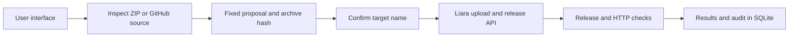

# Rahban architecture

React provides the interface. Express serves the built frontend and API. SQLite stores projects, proposals, jobs, HTTP observations, and audit records.

A root Dockerfile selects the `docker` platform. Initial inspection checks for a `FROM` instruction; the build must still succeed on Liara. Without a Dockerfile, `package.json` and a `start` script select `node`. The sample includes a Dockerfile. Archives are inspected in memory and converted to tar.gz. User code is not run on the Rahban server. ZIP input is limited to 10 MB.

The port is inferred from `EXPOSE`, `PORT` in `.env.example`, or recognized JavaScript patterns, in that order; the fallback is 3000. Port, health path, response timeout, and build cache can be changed before approval and are fixed in the proposal. Environment-variable detection covers JavaScript/TypeScript; required values must be configured in Liara.

Proposals expire after 15 minutes and are bound to the destination, account, team, connection settings, and archive contents. Approval is single-use. Concurrent operations on one target are rejected. Jobs interrupted by a process restart are marked `interrupted` and are not replayed automatically.

Application creation, deployment, and restart each require approval. Deployment and restart require three consecutive HTTP 2xx responses after the operation. Redirects are not followed and do not count as success. Release polling that cannot establish a final result leaves the job as `needs_attention` for a later check. HTTP success does not establish correctness of every website route.

Checks are explicit or follow an operation; no periodic observer runs. Optional model advice uses logs and HTTP evidence and has no execution tools.

## Liara API

`server/liara.js` calls `https://api.liara.ir`. The token stays on the server, the team ID is sent as `teamID`, and redirects are rejected.

| Operation | Endpoint |
|---|---|
| List and inspect applications | `GET /v1/projects`, `GET /v1/projects/:app` |
| Account plans | `GET /v1/me` |
| Create application | `POST /v1/projects/` |
| Upload tar.gz | `POST /v2/projects/:app/sources` |
| Create and inspect release | `POST /v2/projects/:app/releases`, `GET /v1/releases/:id` |
| Read logs | `GET /v2/projects/:app/logs` |
| Restart application | `POST /v1/projects/:app/actions/restart` |

Docker releases use `type: 'docker'` and `build.dockerfile: 'Dockerfile'`. This table describes the implemented adapter; code and simulated responses are not evidence of a successful live account connection.

## Runtime and scope

Docker Compose runs one application container with a persistent SQLite volume and a host port bound to loopback. Public hosting requires HTTPS, an exact origin, and operator login. Sessions and keys entered in the UI are held in memory; sign in and reconnect after a restart.

This is a single-operator MVP. High availability, distributed queues, database administration, DNS changes, existing-plan changes, and automatic rollback are not implemented. Deploying to applications with attached disks is blocked.
